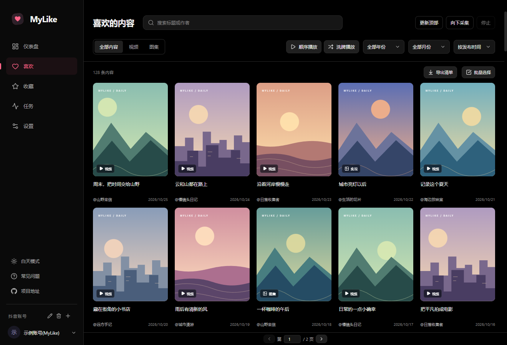
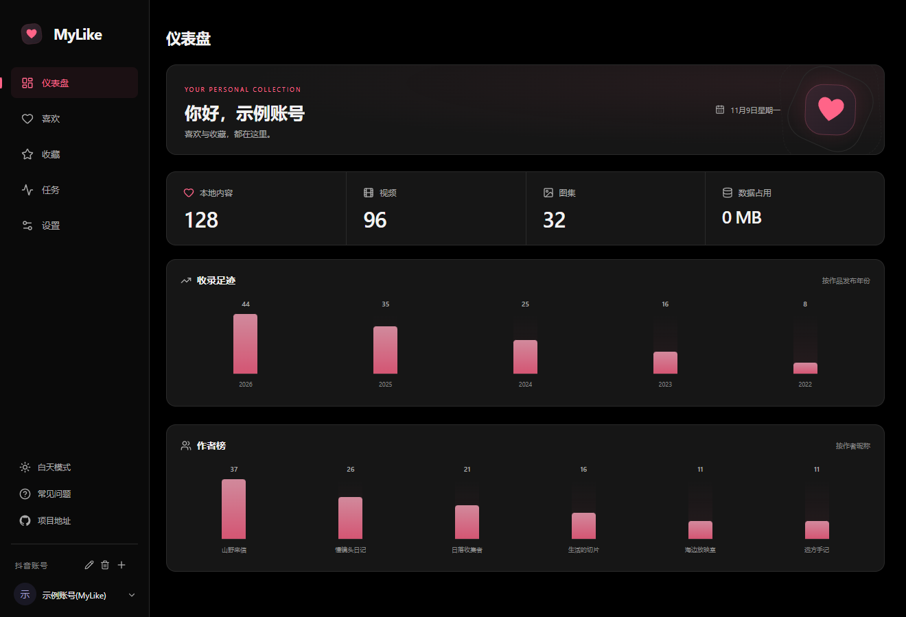

<div align="center">


# MyLike · macOS 社区版

**把喜欢，再喜欢一遍。**

一个整理、搜索和回看抖音喜欢与收藏的 macOS 社区维护版本。

已适配上游 v2.0.7（1400645），支持分页与滚动浏览、批量框选与反选、经典主题，以及喜欢和收藏的手机清单导出，Mac 社区版本号为 `2.0.7-Macos`。

基于 [Hannah2227/douyin-favorite-MyLike](https://github.com/Hannah2227/douyin-favorite-MyLike) 开发。Mac 的开发、测试、发版和问题反馈由本 Fork 承担；Windows 版本由[上游项目](https://github.com/Hannah2227/douyin-favorite-MyLike)维护。Mac 问题请在[本仓库 Issues](https://github.com/billybobz-design/douyin-favorite-MyLike/issues)反馈。

[](https://github.com/billybobz-design/douyin-favorite-MyLike/releases)
[](https://github.com/billybobz-design/douyin-favorite-MyLike/releases)
[](https://github.com/billybobz-design/douyin-favorite-MyLike/actions/workflows/desktop.yml)
[](LICENSE)

[](https://github.com/billybobz-design/douyin-favorite-MyLike/stargazers)
[](https://github.com/billybobz-design/douyin-favorite-MyLike/forks)
[](https://github.com/billybobz-design/douyin-favorite-MyLike/releases)

[下载应用](https://github.com/billybobz-design/douyin-favorite-MyLike/releases) · [功能特性](#功能特性) · [界面预览](#界面预览) · [反馈问题](https://github.com/billybobz-design/douyin-favorite-MyLike/issues)

</div>

## 界面预览

| 喜欢的内容 | 仪表盘 |
| :---: | :---: |
| <a href="assets/readme/likes-preview.png"></a> | <a href="assets/readme/dashboard-preview.png"></a> |

## v2.0.7 社区版进度

当前源码版本为 `2.0.7-Macos`。本地 Apple Silicon 安装包位于 `apps/desktop/dist/`，可使用同目录的 SHA-256 校验文件核对。GitHub 构建包可在对应的 Actions 运行页面查看。

## 下载

目前 GitHub Releases 提供 [v2.0.5 Mac 版](https://github.com/billybobz-design/douyin-favorite-MyLike/releases/tag/v2.0.5-Macos)，最低系统要求为 macOS 13。

| Mac 芯片 | 下载 |
| --- | --- |
| Apple Silicon（M 系列） | [MyLike-macOS-arm64.zip](https://github.com/billybobz-design/douyin-favorite-MyLike/releases/download/v2.0.5-Macos/MyLike-macOS-arm64.zip) |
| Intel | [MyLike-macOS-x64.zip](https://github.com/billybobz-design/douyin-favorite-MyLike/releases/download/v2.0.5-Macos/MyLike-macOS-x64.zip) |

解压后使用对应架构的 DMG 安装。社区测试包使用临时签名（ad-hoc），未经 Apple 公证。升级前建议备份应用数据，使用 ⌘Q 完全退出旧版，再替换应用。

Mac 保留原生标题栏和菜单，支持 ⌘C / ⌘V / ⌘A 等编辑操作。关闭主窗口（红色按钮或 ⌘W）会隐藏窗口，后台任务和播放会继续；点击 Dock 图标或按 ⌘1 恢复窗口。使用 ⌘Q 或 MyLike 菜单中的退出，保存进度并退出应用。

Windows 用户请前往[原作者发布页](https://github.com/Hannah2227/douyin-favorite-MyLike/releases)下载与反馈；本仓库负责 Mac 社区版本。

## 功能特性

- **喜欢与收藏**：增量采集、断点续采、收藏夹同步与按夹浏览；播放中收藏、多选加入收藏夹及新建收藏夹。
- **同步整理**：单条或批量取消抖音点赞、收藏，平台确认后同步更新本地记录；批量选择支持反选，播放页取消单条点赞可选择下次不再提示。
- **随手找到**：标题 / 作者搜索，类型与年月筛选，支持每页 100 条的分页浏览（可输入页码跳转）和滚动浏览。喜欢列表可按作品发布时间或抖音点赞先后排序。
- **沉浸回看**：顺序 / 洗牌、断点续播、视频 / 图集 / 实况原声混音、倍速、全屏、清屏、播放列表与自定义快捷键；复用播放详情更新封面链接，不额外请求详情接口。
- **应用内评论**：边播放边浏览评论，滚动到底部会自动加载主评论，也可展开楼中楼，沿用应用内的抖音登录会话。
- **边采边看**：后台采集或取消点赞、收藏时继续播放，任务进度和异常集中管理，统一核验登录、喜欢与收藏状态。
- **本地管理**：多账号隔离、账号改名与删除、手机清单导出、批量整理与关键操作自动备份。
- **按你的习惯**：白天、经典和黑夜三种主题，支持界面缩放、窗口记忆、播放偏好与内容仪表盘，按年份和作者查看收录数量。

## 快速上手

1. **添加账号并登录**：在应用打开的抖音窗口中完成扫码登录，身份核验成功后窗口自动收起。
2. **收录内容**：喜欢与收藏统一使用“更新顶部、向下采集、停止”：获取新内容、继续历史采集或保存进度停止；收藏同时支持收藏夹同步与按夹浏览。
3. **开始回看**：直接点播，或在筛选范围内顺序 / 洗牌播放。清屏时按 Esc 或清屏快捷键退出，默认 H，可在设置修改。

任务受阻时，到“任务”点击“核验状态”，查看绿色正常、黄色不明确或红色异常及对应建议。需要登录或验证时会打开抖音窗口，完成后自动收起；收藏采集因页面异常中断时，可从原断点核验并尝试续采。更多操作见应用内的「常见问题」。

macOS 默认将数据保存在 `~/Library/Application Support/MyLikeElectron`。在「设置 → 数据与存储」可更改目录。

本地删除与远端取消点赞、收藏是不同操作，远端取消前默认要求确认；播放页取消单条点赞可选择下次不再提示，并可在设置中恢复。批量取消及取消收藏仍需确认。取消收藏会移除全部收藏夹关联，喜欢记录保留。

## 开发

使用 Electron + TypeScript + React + SQLite。需要 Node.js 24.12+、pnpm 11.22。

```sh
cd apps/desktop
pnpm install --frozen-lockfile
pnpm exec install-electron
pnpm dev
```

`pnpm test` 运行单元测试，`pnpm test:e2e` 运行桌面集成测试，`pnpm package:win` 生成 Windows 安装包。旧版源码、测试和构建流程统一保存在 [`legacy/`](legacy/)。

### 构建 Mac 版本

在 Mac 上使用上述 Node.js / pnpm 环境。修改品牌 SVG 后运行 `pnpm icons`，同时生成 Windows 图标和包含 Retina 分辨率的 Mac ICNS 图标。

```sh
# 当前 Mac 芯片架构，生成临时签名的 DMG 和 ZIP 测试包
pnpm package:mac

# 指定架构（可以交叉打包，运行测试需在对应架构验证）
pnpm package:mac --arm64
pnpm package:mac --x64

# 仅生成 .app，用于本机测试
pnpm package:mac:dir
```

打包后运行 `pnpm verify:mac`，检查应用版本、架构、签名完整性和 DMG 内的应用目录。工作流也执行该检查；临时签名通过完整性检查不代表已获 Apple 公证。

输出位于 `apps/desktop/dist/`。Apple Silicon 的应用路径为 `dist/mac-arm64/MyLike.app`，Intel 为 `dist/mac/MyLike.app`。打包工具按目标架构获取 Electron，不复用本机其他架构的运行时。

集成测试使用临时数据目录与受控接口，不需要真实抖音账号。可用 `MYLIKE_EXECUTABLE` 指向打包后的可执行文件，例如：

```sh
MYLIKE_EXECUTABLE="$PWD/dist/mac-arm64/MyLike.app/Contents/MacOS/MyLike" pnpm test:e2e
```

真实扫码登录、人工验证、在线播放和实际账号同步仍需另外人工验收；CI 测试不能代替这些检查。

### Mac 社区版的测试与发布

本仓库的 **macOS community** 工作流只运行 Mac 构建与测试，分别使用原生 Apple Silicon 和 Intel runner。自动化测试使用临时数据和受控接口；真实账号流程需要另外人工验收。

正式分发可使用 Developer ID Application 证书与 Apple 公证。`pnpm package:mac:signed --arm64` / `--x64` 要求有效签名证书；签名与公证凭据保存在本 Fork 的 Actions Secrets 中，不提交到源码。配置参见 [electron-builder 26 文档](https://www.electron.build/v26/docs/features/code-signing/)。

| Secret                        | 用途                                               |
| ----------------------------- | -------------------------------------------------- |
| `MAC_CSC_LINK`                | Base64 编码的 Developer ID Application `.p12` 证书 |
| `MAC_CSC_KEY_PASSWORD`        | 证书密码（无密码时可留空）                         |
| `APPLE_ID`                    | 用于公证的 Apple ID                                |
| `APPLE_APP_SPECIFIC_PASSWORD` | Apple 专用 App 密码                                |
| `APPLE_TEAM_ID`               | Apple Developer 团队 ID                            |

后续发布流程：

1. 在本 Fork 修改源码，更新 `apps/desktop/package.json` 版本，完成自动化测试和真实账号人工验收。
2. 创建并推送实际 Git 标签，例如 `v2.0.7-Macos`，无需固定前缀或与 `package.json` 版本相同。手动运行工作流时，在 `main` 上填写已存在的 `release_tag`，会构建该标签指向的源码；也可选择包含新版工作流的标签直接运行。Release 使用实际标签名，安装包文件名与应用内版本仍来自该标签源码的 `package.json`。需要正式签名时勾选 `sign_mac` 并配置上述 Secrets。
3. 两种架构全部构建、测试成功后，工作流在本 Fork 创建带安装包和校验文件的**草稿预发布版**。不覆盖已发布版本或同名附件。
4. 维护者核对安装包、签名状态和验收说明后再发布草稿。普通主分支 / PR 检查，以及选择分支且不填写 `release_tag` 的手动运行只生成 Actions 产物；手动选择标签或填写 `release_tag` 时创建对应标签的草稿。已有旧标签仍包含旧版工作流，请选择 `main` 并填写旧标签名，以使用本次修正的发布规则。

Mac 的 CI、签名凭据、Releases 和 Issues 都在本仓库运行及维护。上游仅提供社区版入口，不承担 Mac 测试、发布或问题支持。

## 免责声明

- 本项目用于个人学习与账号内容整理，与抖音 / 字节跳动无关联，未经其授权或背书。
- 请仅访问和整理本人账号或已获授权的数据，遵守适用法律法规、平台服务条款及内容权利人的合法权益。请勿用于未经授权的采集、侵权传播或其他滥用行为。
- 视频、图片、音乐等内容的权利归原权利人所有；本地收录不代表获得转载、传播或其他使用授权。
- 平台接口、访问限制或内容状态变化可能导致功能不可用、采集不完整。请自行备份重要数据，并在批量取消点赞等操作前确认账号和范围。
- 软件按现状提供，不保证持续可用或适用于特定用途。在适用法律允许的范围内，作者不承担因使用本软件产生的账号限制、数据丢失等损失责任；具体以 [MIT License](LICENSE) 的担保与责任条款为准。

## 许可证

本项目采用 [MIT License](LICENSE)，第三方组件保留各自的版权和许可证，相关声明随发行包提供。
